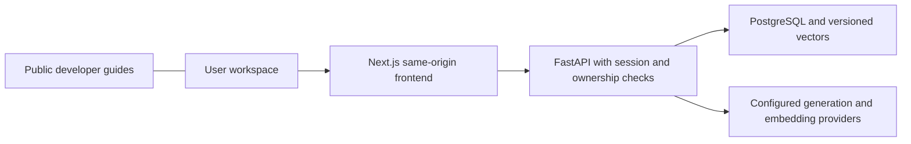

# Onesa AI Platform

Onesa AI Platform is Onesa UG's general-purpose AI workspace for Chat, Knowledge,
Agents and Travel. It serves European and international applications; regional
language/domain adaptation is an additional specialization. Existing open-weight
models come first, with evaluated fine-tuning kept separate.

The Next.js workspace calls its own FastAPI service through a same-origin proxy.
PostgreSQL/pgvector stores owned application records and versioned retrieval data.
Configurable mock, Ollama, vLLM and authenticated Cloudflare adapters preserve the
same application contract. Local mock operation does not prove hosted inference.



## Capabilities and boundaries

- Chat streams responses with context, history, rename/delete, Stop and explicit failures.
- Knowledge validates text/PDF uploads, extracts and indexes content, restricts retrieval
  by owner, exposes citations and supports deletion/reindexing.
- Agents run registered bounded tools with explicit permission and an execution record.
  The current tool is text statistics; arbitrary external actions are unavailable.
- Travel persists editable itinerary suggestions. Unconfigured live providers do not
  supply prices, availability, bookings or reservations.
- Identity includes sessions/CSRF, invitation/recovery workflows, rate limits and ownership.
  An ordinary account does not grant engineering or administrative access.
- Local model/evaluation tooling is separate from application serving. Training, new
  model downloads, customer-data reuse and GPU provisioning need their own scope.

The shared [Onesa design contract](docs/architecture/ONESA_DESIGN_SYSTEM.md) uses
indigo AI and calm Docs variants, familiar controls and system-controlled light/dark.
There is no appearance selector, clock schedule or stored appearance override.
Language preferences are separate. English/German navigation and identity catalogs
are implemented; other workspace copy remains English and is not claimed fully translated.

## Repository

| Location | Responsibility |
| --- | --- |
| `onesa-ai-platform-frontend/apps/chat` | Next.js Chat/Knowledge/Agents/Travel workspace |
| `onesa-ai-platform-frontend/apps/docs` | Separately classified public/internal Docusaurus builds |
| `onesa-ai-platform-frontend/packages/api-client` | Generated contracts and bounded SSE transport |
| `onesa-ai-platform-backend` | FastAPI, Alembic, tests and optional model tooling |
| `docs` | Classified engineering references and approved public sources |
| `scripts`, `infra`, `.github/workflows` | Verified build, operations and delivery tooling |

This is an independent Git repository in the three-product `onesa-ug` workspace.
Frontend/backend builds use their own contexts; builds do not import sibling source.

## Local quickstart

Use Node 24, Python 3.11 and Docker with Compose. From this repository root:

```sh
python3 scripts/bootstrap_env.py
make up
```

The generated private `.env` supplies development secrets. Open the configured loopback
Chat origin (default `http://localhost:3000`). If changing the port, update both
`ONESA_CHAT_PORT` and `ONESA_PUBLIC_ORIGIN`. `make down` stops the stack while preserving
volumes. Never use production credentials/data for local setup. Environment examples
are placeholders, and provider tokens remain server-only.

Fresh setups use explicitly labeled mock inference and a lexical retrieval baseline.
For native Apple Silicon Ollama or real hosted provider configuration, follow the
[local development guide](docs/deployment/LOCAL_DEVELOPMENT.md) and
[model setup](docs/models/OLLAMA_SETUP.md). These are optional dependencies and do not
change the smallest local path.

## Verification and contributions

```sh
make install check
npm --prefix onesa-ai-platform-frontend run ci
make frontend-check
make openapi api-client contract-check
node scripts/test_system_appearance.mjs
python3 scripts/repository_hygiene.py
```

Real database tests require the isolated `_test` database in
[Build and Test](docs/engineering/BUILD_AND_TEST.md); those tests reset fixtures and
must never point at staging/production. Browser tests distinguish mock regression from
real provider acceptance. [Engineering Onboarding](docs/onboarding/START_HERE.md)
explains the four-day path and first contribution. Read [AGENTS.md](AGENTS.md) before
changes and preserve concurrent work. Keep dev/staging/main as the three permanent
branches. Temporary Dependabot security-fix PRs and reviewed security candidates are
allowed; qualify fixes in existing staging, keep owner-controlled production release
and reconcile them into dev/staging. Ordinary version PR automation stays disabled.

Delivery qualifies exact source/artifacts through CI, hosted staging, scoped legal and
operational evidence, owner-controlled promotion and production acceptance. The
[deployment guide](docs/engineering/DEPLOYMENT.md) records commands and restrictions.
GitHub Free limitations mean a written convention is not enforced branch protection.
No local check or prior staging result alone establishes a new production release.

## Documentation, reporting and status

[Onesa Developer Docs](https://docs.onesa.eu) publishes approved external guides.
Engineering docs use a separate authenticated build; obtain approved access through
[Engineering Onboarding](docs/onboarding/START_HERE.md). Restricted evidence,
credentials, customer records and raw backups are excluded from both websites.

Report vulnerabilities privately to [info@onesa.eu](mailto:info@onesa.eu), or use
GitHub private vulnerability reporting if verified enabled. Provide proportionate,
sanitized reproduction information; never post sensitive details publicly or send
passwords, tokens or customer records. No response-time guarantee is asserted.
Support currently covers the latest reviewed main revision; a historical release
support policy remains unresolved.

Product scope and open work are maintained in the [roadmap](docs/product/ROADMAP.md),
[documentation index](docs/README.md) and protected release evidence. Real hosted
inference, privacy decisions, operational qualification and production rollout remain
separate gates. [CHANGELOG.md](CHANGELOG.md) records the truthful launch state.
Software licensing/ownership remains unresolved; no open-source license is invented.
Maintainer: Onesa UG (haftungsbeschränkt), [info@onesa.eu](mailto:info@onesa.eu).
