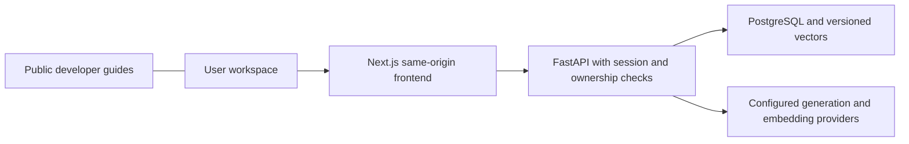

# Onesa AI Platform

Server gateway imports and traced-bundle checks keep the Node trust policy in
serverless artifacts as well as conventional Node startup.

Node application startup has a narrowly scoped CA trust policy, with isolated
regressions in `node --test scripts/test_tls_trust.mjs`. Use Node 24.12+ in the 24
series. Source implementation is separate from the accepted component releases
recorded below; no production update follows merely from merging source.

Production API hosting moved to the existing Oracle Free VM on 2026-10-16; the
Vercel frontend and existing data services remain. See the
[verified hosting cutover](docs/engineering/DEPLOYMENT.md#verified-production-hosting-cutover--2026-10-16)
for source identities, protected ingress, acceptance and rollback.

Public Docs source `373889be9bda3357ff50b74692e9b75637e2bb59` is accepted at
`docs.onesa.eu`, Vercel `dpl_4h1tQYKcCssNgrsEwPUL2DnjKFEi` (2026-10-22).
The source-bound native Preview passed all 279 public file hashes, 124 responsive/
accessibility views, 20 additional layout checks, 21 diagram journeys and 11 PDF
checks. Canonical production verifies all 279 qualified file hashes, 16 responsive/
accessibility views and six private-path denials. DOMPurify 3.4.17 is included in
the qualified artifact; SSO, domains, credentials and AI services are unchanged.
The earlier public edition `4f30218dca47d1197a0cb88b25a16bd33696832a` /
`dpl_GXToVcRYjwsRhDQqfwN84zLfkey2` remains retained release history.
AI frontend security candidate `ac7f840938b39c3d22f2d7a90460578684ecbafe` is
accepted on `platform.onesa.eu` (2026-10-22), with Next.js 16.4.2 verified in the
sealed traced artifact, full native CI, 48 staged views and 16 canonical views.
Private denials, readiness and served asset hashes passed. It preserves the
preceding production application UI/proxy source and retains API `7079a66` with
its accepted image, container and runtime configuration. It does not activate
Industrial functionality. Its temporary security branch remains retained for
release/rollback evidence; the same dependency fix follows dev → staging → main.
The preceding `b2e93529e9ed6e8c1f566f1a2f8a741d05b48bd6` frontend carried the
Node TLS correction (2026-10-21). Those trust controls remain preserved. Prior
23 real workflow checks and 42 UI views retain their original independent scope;
no new real-model or authenticated production walkthrough is inferred from the
security-only frontend checks. Actual provider receipts remain in the restricted
component-serving manifest, separate from repository metadata commits.
On 2026-10-22, backend source `7079a66dc0c2fc9de9cd632894b45a9a5cea5048`
was independently accepted with `pypdf 6.21.2` verified in staging and production.
Its application code and schema are unchanged from the preceding backend; runtime,
credential and record-identifier preservation checks passed. Canonical readiness and
private-access denials pass. This parser patch introduced no production model request,
new account or Industrial feature. The frontend and both Docs retain independent identities.
Protected Engineering Docs source `373889be9bda3357ff50b74692e9b75637e2bb59`
is independently accepted at `docs.engineering.onesa.eu`, Pages
`2d937ff1-391f-4156-8df6-75d2d14aaa5e` (2026-10-22), with DOMPurify 3.4.17
and factual isolated-demo documentation. All 751 private assets and anonymous denials,
18 production responsive/accessibility views, 18 architecture topics, 17 chapters,
four onboarding days, 22 manuals and 87 diagrams pass. Staging reuses completed
751-asset/denial and 18-view evidence with only its unfinished architecture/onboarding
tail continued; the original stopped observation is preserved.
Actual approved-owner membership/access and supported Access logout/refusal were
observed, including the retained Preview cookie without extracting session values.
The original email challenge was owner-confirmed, not independently witnessed.
No membership, password, MFA or provider policy changed; no private artifact entered
public GitHub Actions. This supersedes protected source `34e9ab8` / Pages `48d6eebd`;
repository metadata commits remain distinct from each accepted component identity.

Industrial Investigation V1 is implemented at `/industrial`, using only bundled
synthetic assets and original versioned reference text. Deterministic facts, bounded
source-cited hypotheses or abstention, owned internal drafts and explicit save/reopen
are qualified in the isolated synthetic staging demo. Its original real-model context
passed 42 general and 16 Industrial UI views: three stops/720 seconds, one permitted
citation and one validated explanation. Automated self-review is not human domain approval.
The current demo frontend `373889be9bda3357ff50b74692e9b75637e2bb59`, Vercel
`dpl_AAX1uyYoBpcmZ1biJ6BmnJZvDLSQ`, uses Next.js 16.4.2. Sixty anonymous views
and existing synthetic-owner login/assets/logout checks pass, reusing the original
model acceptance only after business/UI/API equivalence checks. API `3574f21` and its
image/database are unchanged; only the exact Preview origin required one isolated
API container recreation. No additional model request, schema, password or grant
change accompanied that update. Demo grants retain their original expiry.
Ordinary production has not received Industrial code. No live factory/customer
connector, external work order, physical operation, human-domain result or comparative
accuracy/business benefit is claimed. See the [PRD](docs/product/PRD.md#v1-event-semantics-and-working-scope)
and `scripts/evaluate_industrial.py` for the finite fixture and evidence scope.

Onesa AI Platform is Onesa UG's general-purpose AI workspace for Chat, Knowledge,
Agents and Travel. It serves European and international applications; regional
language/domain adaptation is an additional specialization. Existing open-weight
models come first, with evaluated fine-tuning kept separate.

The Next.js workspace calls its own FastAPI service through a same-origin proxy.
PostgreSQL/pgvector stores owned application records and versioned retrieval data.
Configurable mock, Ollama, vLLM and authenticated Cloudflare adapters preserve the
same application contract. Local mock operation does not prove hosted inference.



## Product tracks

**Applications** includes Chat, Knowledge, Agents and Travel. **Industrial AI** has
a qualified synthetic investigation demonstration for evidence-backed operational
investigation and internal drafts; broader industrial integrations remain planned. The focused milestone and evaluation contract are in the
[existing product requirements](docs/product/PRD.md#current-product-hierarchy-and-industrial-milestone--2026-10-20).
No live machine/PLC/MES/ERP/CMMS connection or autonomous industrial control is claimed.
Onesa Robotics / Physical AI remains a separate product development line.

## Capabilities and boundaries

- Chat streams responses with context, history, rename/delete, Stop and explicit failures.
- Knowledge validates text/PDF uploads, extracts and indexes content, restricts retrieval
  by owner, exposes citations and supports deletion/reindexing.
- Agents run registered bounded tools with explicit permission and an execution record.
  Registered tools include arithmetic and text statistics; arbitrary external actions are unavailable.
- Travel persists editable itinerary suggestions. Unconfigured live providers do not
  supply prices, availability, bookings or reservations.
- Identity includes sessions/CSRF, invitation/recovery workflows, rate limits and ownership.
  An ordinary account does not grant engineering or administrative access.
- Local model/evaluation tooling is separate from application serving. Training, new
  model downloads, customer-data reuse and GPU provisioning need their own scope.

The shared [Onesa design contract](docs/architecture/ONESA_DESIGN_SYSTEM.md) uses
indigo AI and calm Docs variants, familiar controls and system-controlled light/dark.
There is no appearance selector, clock schedule or stored appearance override.
Language preferences are separate. English/German navigation and identity catalogs
are implemented; other workspace copy remains English and is not claimed fully translated.

## Repository

| Location | Responsibility |
| --- | --- |
| `onesa-ai-platform-frontend/apps/chat` | Next.js Chat/Knowledge/Agents/Travel workspace |
| `onesa-ai-platform-frontend/apps/docs` | Separately classified public/internal Docusaurus builds |
| `onesa-ai-platform-frontend/packages/api-client` | Generated contracts and bounded SSE transport |
| `onesa-ai-platform-backend` | FastAPI, Alembic, tests and optional model tooling |
| `docs` | Classified engineering references and approved public sources |
| `scripts`, `infra`, `.github/workflows` | Verified build, operations and delivery tooling |

This is an independent Git repository in the `onesa-ug` workspace.
Frontend/backend builds use their own contexts; builds do not import sibling source.

## Local quickstart

Use Node 24, Python 3.11 and Docker with Compose. From this repository root:

```sh
python3 scripts/bootstrap_env.py
make up
```

The generated private `.env` supplies development secrets. Open the configured loopback
Chat origin (default `http://localhost:3100`). If changing the port, update both
`ONESA_CHAT_PORT` and `ONESA_PUBLIC_ORIGIN`. `make down` stops the stack while preserving
volumes. Never use production credentials/data for local setup. Environment examples
are placeholders, and provider tokens remain server-only.

Fresh setups use explicitly labeled mock inference and a lexical retrieval baseline.
For native Apple Silicon Ollama or real hosted provider configuration, follow the
[local development guide](docs/deployment/LOCAL_DEVELOPMENT.md) and
[model setup](docs/models/OLLAMA_SETUP.md). These are optional dependencies and do not
change the smallest local path.

## Verification and contributions

```sh
make install check
npm --prefix onesa-ai-platform-frontend run ci
make frontend-check
npm ci --ignore-scripts --prefix scripts/contract-tools
make openapi api-client contract-check
node scripts/test_system_appearance.mjs
python3 scripts/repository_hygiene.py
```

Real database tests require the isolated `_test` database in
[Build and Test](docs/engineering/BUILD_AND_TEST.md); those tests reset fixtures and
must never point at staging/production. Browser tests distinguish mock regression from
real provider acceptance. [Engineering Onboarding](docs/onboarding/START_HERE.md)
explains the four-day path and first contribution. Read [AGENTS.md](AGENTS.md) before
changes and preserve concurrent work. Keep dev/staging/main as the three permanent
branches. Temporary Dependabot security-fix PRs and reviewed security candidates are
allowed; qualify fixes in existing staging, keep owner-controlled production release
and reconcile them into dev/staging. Ordinary version PR automation stays disabled.

Delivery qualifies exact source/artifacts through CI, hosted staging, scoped legal and
operational evidence, owner-controlled promotion and production acceptance. The
[deployment guide](docs/engineering/DEPLOYMENT.md) records commands and restrictions.
Current public repositories enforce main PR/check, force-push and deletion protection; see the branch-protection report.
No local check or prior staging result alone establishes a new production release.

## Documentation, reporting and status

[Onesa Developer Docs](https://docs.onesa.eu) publishes approved external guides.
Engineering docs use a separate authenticated build; obtain approved access through
[Engineering Onboarding](docs/onboarding/START_HERE.md). Restricted evidence,
credentials, customer records and raw backups are excluded from both websites.

Report vulnerabilities privately to [info@onesa.eu](mailto:info@onesa.eu), or use
GitHub private vulnerability reporting if verified enabled. Provide proportionate,
sanitized reproduction information; never post sensitive details publicly or send
passwords, tokens or customer records. No response-time guarantee is asserted.
Support currently covers the latest reviewed main revision; a historical release
support policy remains unresolved.

Product scope and open work are maintained in the [roadmap](docs/product/ROADMAP.md),
[documentation index](docs/README.md) and protected release evidence. Real hosted
inference, privacy decisions, operational qualification and production rollout remain
separate gates. [CHANGELOG.md](CHANGELOG.md) records the truthful launch state.
Software licensing/ownership remains unresolved; no open-source license is invented.
Maintainer: Onesa UG (haftungsbeschränkt), [info@onesa.eu](mailto:info@onesa.eu).
