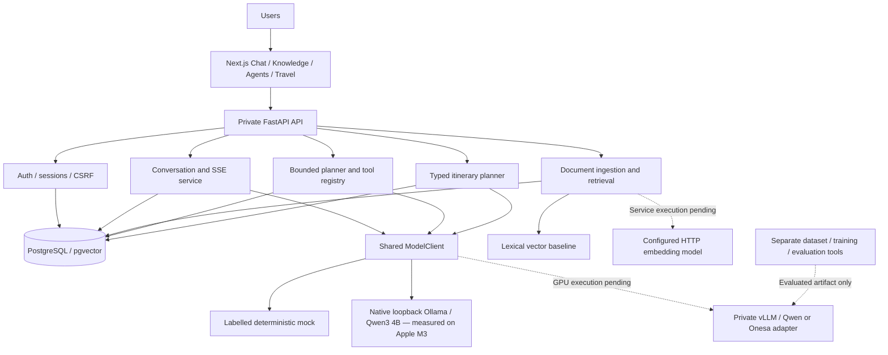
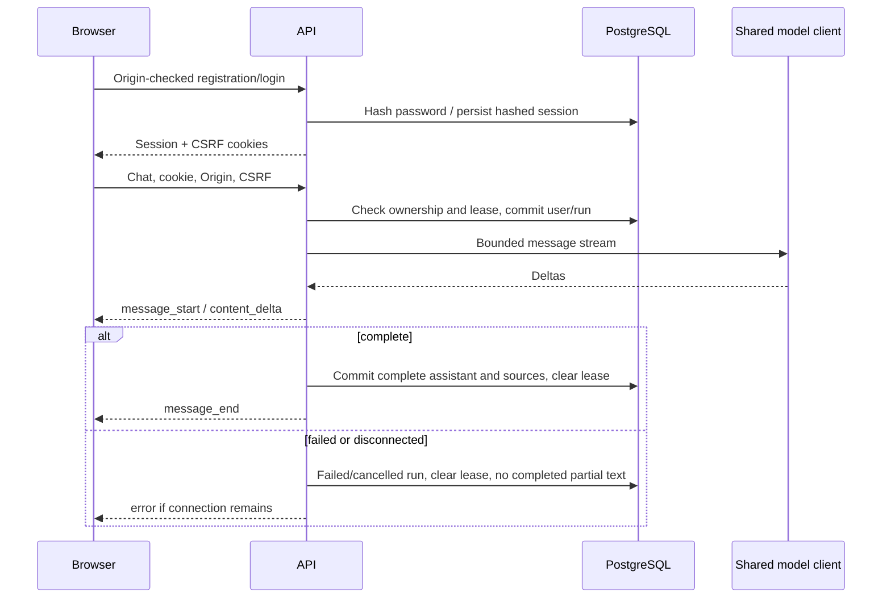
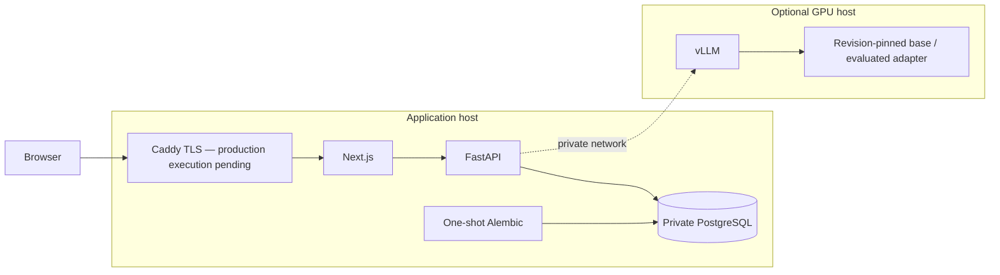
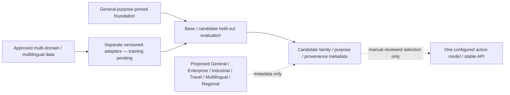

# Architecture diagrams

Onesa AI is European-based, general-purpose and applicable to European and international
markets. Shared services have no geographic routing or country/language whitelist.
African/regional use cases are optional specializations. See ADR 0003 and AI_SOVEREIGNTY.md.

Solid components below are implemented software. GPU/external/production execution is
pending even where the configuration/adapter exists.





```mermaid
sequenceDiagram
  participant API
  participant Knowledge
  participant Embedding as Lexical or HTTP embedding adapter
  participant DB as pgvector
  participant Model
  API->>Knowledge: Authorized document IDs and question
  Knowledge->>Embedding: Query vector
  Knowledge->>DB: Filter owner and version; cosine search
  DB-->>Knowledge: Source excerpts
  Knowledge-->>API: Attributed evidence
  API->>Model: Untrusted evidence + question
  Model-->>API: Output stream
  API->>DB: Persist completed answer and source records
```





European/international audiences use this same pipeline. The diagram describes implemented
metadata/evaluation tools and proposed artifacts, not existing trained models or release approval.
