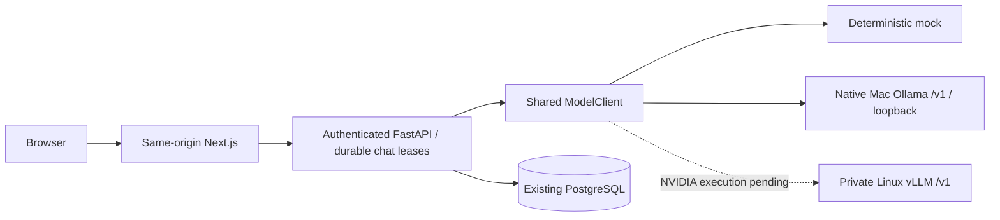

# Interchangeable local model serving

Onesa remains a European-based, general-purpose platform. Business modules consume the
ModelClient protocol; no application/frontend changes are required to choose mock, ollama
or vllm through ONESA_MODEL_BACKEND. OllamaModelClient and VLLMModelClient share the same
OpenAI-compatible discovery/request/SSE implementation. Mock is deterministic and labelled.
Real serving never silently falls back to mock. Images are not accepted by the current typed
text API; model modality declarations are distinct from application input support.

Docker Desktop routes container HTTP to host.docker.internal:11434. Native Ollama stays
bound to 127.0.0.1; this path was actually verified. The browser contacts only authenticated
Onesa APIs. Ollama's local API ignores bearer authentication, so loopback/private-host isolation
is essential; the model key is not an access-control substitute. No inference port is published.

Ollama /v1 cannot choose context per request; the native service sets an 8192-token default.
Actual /api/ps records confirm context and resident allocation. Server token limits complement
the platform's character/history bounds. NVIDIA context/memory remain explicit server options.

GenerationStats uses request-owned context to collect reported usage without shared mutable
state or protocol changes for existing planners/test clients. Missing counts stay null. Completed
assistant JSONB content stores model/metrics provenance and existing run token columns are populated;
no database migration is needed. SSE/nonstream metadata additions preserve existing fields.
Protected Prometheus counters/histograms record backend/outcomes/latency/first-text timing.

Health checks process liveness; readiness checks configured model availability and schema.
For Ollama, discovery proves a model is installed, not resident, warm, accurate or within a
production SLA. Missing model, timeout and connection failures are sanitized; disconnects close
upstream HTTP and preserve only the user turn. Actual model behavior/results are recorded in
models/INFERENCE_BENCHMARKS.md and development/SESSION_HANDOFF.md.

## Qualified local semantic candidate

A separate optional `onesa-ai-platform-backend/embedding_service` now serves pinned
Qwen3-Embedding-0.6B locally on loopback. It has its own dependencies/model storage;
the application image stays independent. The existing versioned pgvector schema remains
256-dimensional. HTTP requests set dimensions=256, document passages have no instruction,
and configured search queries use a retrieval-specific instruction. The candidate revision
includes the query protocol version. Production HTTP embedding configuration requires
TLS/authentication; the actual EU target is unqualified. Active lexical vectors/configuration
are preserved until a planned per-owner reindex. See the semantic qualification report
for the 1024 comparison, failures and exact evidence limits.

### 2026-10-10 release-candidate delta

Backend packaging now pins Python3.11.17 Alpine3.24 by manifest digest and build-only uv0.13.0 by digest. No pip/setuptools/wheel/uv is shipped in the web runtime; real retrieval, inference clients and Linux PDF seccomp remain. Additive SQL stores hold bounded upload chunks, invitation/reset hashes and persistent encrypted mail work plus shared admission leases. Identity worker command is `python -m app.identity_worker`; provisioning/real delivery need scoped approval. Browser5MiB documents use512KiB authenticated chunks through same-origin BFF; no public storage URL. Invitation policy is explicit configuration, not automatically enabled or existing-user eligibility. Core readiness/database and model readiness are separate; production real authenticated HTTPS inference remains unverified. Source/API/docs classification and existing local models/data are preserved. Release remains NO-GO; exact local evidence and unapplied provider delta are restricted under docs/internal/release-audit.

### Hosted infrastructure preparation — 2026-10-10

The approved direction is a separate AI Render PostgreSQL database and a separately
provisioned European GPU host; no GPU endpoint/resource purchase is yet approved.
The actual backend region is Frankfurt. See
[staging-first proposal](../engineering/HOSTED_AI_PROPOSAL.md) and
[actual configuration inventory](../engineering/HOSTED_AI_CONFIGURATION.md).
The GPU proposal uses an authenticated TLS gateway across providers, not Render
private networking. Semantic embeddings remain a separately authenticated service;
256-dimensional schema/version boundaries and backed-up per-owner reindex remain.
Alembic requires only its scoped ONESA_DATABASE_URL; runtime Settings validation
continues to enforce hosted environment, database and authenticated production
inference. Liveness is separate from mandatory real database/core readiness.
No new live database migration or model download was performed.
