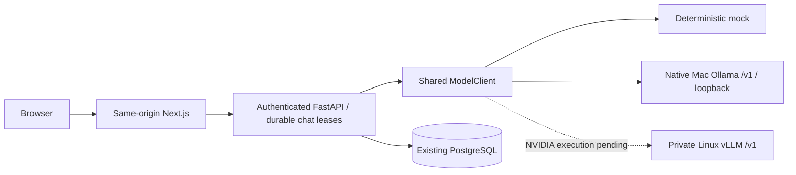

# Interchangeable local model serving

Onesa remains a European-based, general-purpose platform. Business modules consume the
ModelClient protocol; no application/frontend changes are required to choose mock, ollama
or vllm through ONESA_MODEL_BACKEND. OllamaModelClient and VLLMModelClient share the same
OpenAI-compatible discovery/request/SSE implementation. Mock is deterministic and labelled.
Real serving never silently falls back to mock. Images are not accepted by the current typed
text API; model modality declarations are distinct from application input support.

Docker Desktop routes container HTTP to host.docker.internal:11434. Native Ollama stays
bound to 127.0.0.1; this path was actually verified. The browser contacts only authenticated
Onesa APIs. Ollama's local API ignores bearer authentication, so loopback/private-host isolation
is essential; the model key is not an access-control substitute. No inference port is published.

Ollama /v1 cannot choose context per request; the native service sets an 8192-token default.
Actual /api/ps records confirm context and resident allocation. Server token limits complement
the platform's character/history bounds. NVIDIA context/memory remain explicit server options.

GenerationStats uses request-owned context to collect reported usage without shared mutable
state or protocol changes for existing planners/test clients. Missing counts stay null. Completed
assistant JSONB content stores model/metrics provenance and existing run token columns are populated;
no database migration is needed. SSE/nonstream metadata additions preserve existing fields.
Protected Prometheus counters/histograms record backend/outcomes/latency/first-text timing.

Health checks process liveness; readiness checks configured model availability and schema.
For Ollama, discovery proves a model is installed, not resident, warm, accurate or within a
production SLA. Missing model, timeout and connection failures are sanitized; disconnects close
upstream HTTP and preserve only the user turn. Actual model behavior/results are recorded in
models/INFERENCE_BENCHMARKS.md and development/SESSION_HANDOFF.md.
