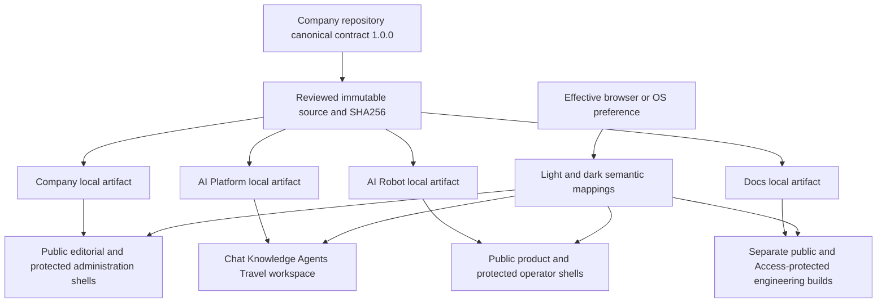

# Onesa Design System

Purpose: maintain the shared interface contract and its independently adopted product variants. Audience: frontend engineers and authorized reviewers. Classification: INTERNAL. Owner: Onesa frontend maintainers; canonical token owner: `DruHustle/onesa-company-portal`. Contract version: 1.0.0. Source verification: 2026-10-14; hosted acceptance is recorded separately in the protected release evidence.

## Foundation and ownership

The Company, AI Platform, AI Robot and Docs experiences share semantic roles and familiar interactions. Each keeps its own authentication, data ownership, framework and release. Chat, Knowledge, Agents and Travel are capabilities within Onesa AI Platform. Administration and operator consoles inherit their product identity.

The canonical CSS source is `onesa-company-portal-frontend/src/styles/onesa-foundation.css` in the Company repository. This repository commits two byte-identical consumer artifacts and records their version, source path and SHA256 in `docs/engineering/design-system.consumer.json`. Builds import only their local copy. Review an owner-source revision, verify its digest, copy the reviewed artifact, update the consumer manifest, run affected checks and promote through `dev → staging → main`. Roll back the consumer independently using its prior qualified artifact. There is no runtime token service or sibling checkout import.

Text alternative: a reviewed Company-owned CSS artifact is deliberately copied and pinned by each consumer. Browser appearance changes semantic presentation locally; it never changes access or release authority. [Architecture & Workflows](/architecture) contains the editable diagram and exports.

## Tokens and product identities

Use `--onesa-font-body` (Arial, Helvetica, sans-serif) and `--onesa-font-code` (system monospace). Existing installed system fonts avoid a new licensed font dependency. The spacing scale is 4, 8, 12, 16, 24 and 32 CSS pixels at the standard root size; controls have a 44-pixel minimum target and a 6-pixel foundation radius. Density may vary by task. Focus is a visible 3-pixel outline with a 4-pixel offset.

| Role | Canonical variables | Consumer mapping |
| --- | --- | --- |
| Canvas and raised content | `--onesa-canvas`, `--onesa-surface` | AI `--bg`, `--panel`; Docs Infima background variables |
| Text and supporting copy | `--onesa-text`, `--onesa-muted` | AI `--ink`, `--muted`; Docs font variables |
| Controls and separators | `--onesa-border`, `--onesa-divider` | AI `--line`; Docs table/menu/navbar variables |
| Actions and focus | `--onesa-accent`, `--onesa-on-accent`, `--onesa-focus` | Product primary actions, current navigation and focus |
| Status | success, warning, error, info and corresponding surface roles | Meaning stays constant across products |

| Product | Explicit name and shell | Accent direction |
| --- | --- | --- |
| Company | Onesa / Company; Company Portal / Administration | Navy/blue with restrained cyan |
| AI | Onesa AI Platform; focused persistent workspace navigation | Indigo |
| Robot | Onesa AI Robot; public story or Operator Console | Teal |
| Docs | Onesa Developer Docs or Onesa Engineering Docs; technical publication | Neutral/slate with restrained blue |

Set deterministic `data-onesa-product` on the root HTML element. Product names, document titles, layout and relevant imagery provide identity even without color. Non-production environment labels come from trusted deployment configuration; operational simulation/live/stale labels come from actual data. Neither follows the palette.

## Appearance and accessible behavior

CSS `prefers-color-scheme` controls light/dark mappings and native `color-scheme`. A readable light base applies when the feature is unavailable. The earlier application clock schedule is superseded. There is no appearance selector, preference cookie, database field or application storage override. Language and onboarding progress preferences remain separate.

Next.js renders deterministic markup and imports local CSS. Docusaurus 3.10.2 uses `respectPrefersColorScheme: true` and `disableSwitch: true`: its installed initial script ignores persisted/query appearance choices, removes only the obsolete theme slot, and its cleaned-up media listener updates code/Mermaid context without persisting mode changes. CSS supplies the actual surfaces independently. Never suppress hydration errors to hide appearance defects.

Preference changes must preserve focus, scroll, drafts, selected documents, stream cancellation state and healthy subscriptions. Avoid app remounts, clock timers, theme API calls and blanket storage clearing. Reduced-motion and forced-colors preferences take precedence. Print output is fixed to readable light text/surfaces. Captured screenshots and locally rendered diagram exports retain their original colors inside a readable containing surface; do not invert images or private media.

Use visible labels/icons with success, pending, unavailable, warning and failure. Teal product identity is not an online signal. Use primary actions for the task, neutral secondary actions and explicit destructive wording/confirmation where the established authorization requires it. Maintain hover, pressed, focus, selected, disabled, busy, validation, success and dependency-failure states. Preserve input on recoverable errors and announce failures with `role="alert"`; never claim saved, connected or delivered before the corresponding result.

Measure ordinary text at 4.5:1 and qualifying large text and applicable non-text indicators at 3:1 in both modes. Keyboard, zoom, 320–1440-pixel layouts, mobile menus, translated labels and long values require browser checks. Contrast names and automated scanners do not constitute accessibility certification.

## Navigation, identity assets and imagery

The logo links to the current product home; the active capability has `aria-current="page"`. Account controls stay product scoped. External product links use the unique Onesa UG, Onesa AI Platform, Onesa AI Robot and Onesa Developer Docs labels and indicate leaving the current product. Navigation does not merge sessions or confer access.

Preserve the approved master mark and recorded source/rights. Use existing approved favicon derivatives and router metadata; do not invent an official mark or add a service worker for icons. Validate icon bytes, dimensions, MIME, HTTP status, document titles and actual tabs at each deployed target. Private customer content, governance records and live telemetry never become decorative screenshots. Internal annotated examples use synthetic fixtures and captions.

Identity icons version 1.0.0 trace the common O from the unchanged, owner-supplied Company orbit artwork. Company uses a square frame, AI a diamond, Robot a circle and Docs a folded book, with their approved product accents. The consumer manifest pins each local provenance record and its derivative hashes. SVG, 16/32/64-pixel ICO frames and the 180-pixel Apple icon provide small-size and browser fallbacks. These technical derivatives do not assert a new official or registered logo. Both public and protected Docs use the Docs identity; access and environment remain separate labels. Native browser-tab appearance must be verified after deployment, alongside metadata and response checks.

Do use a compact form/card and precise unavailable state in a workspace. Do not introduce a marketing hero into Chat, a governance table or operator telemetry. Do use a clear source and capture caption for documentation screenshots. Do not invent activity, compliance scores, physical capability or commercial milestones for appearance.

## Representative verification and maintenance

Chat annotations: the product name identifies Onesa AI Platform; the capability navigation stays within that product; the model strip reports its actual configured scope; the composer keeps drafts and Stop independent of appearance. This is a sanitized synthetic application capture, not customer content or a hosted production-readiness claim.

Knowledge annotations: labels and validation identify accepted files; document actions belong to the authenticated workspace; results link to owned source material; a missing provider/document stays an explicit state. Captured appearance is retained on a containing surface. Screenshot source/rights: Onesa application UI and dedicated synthetic fixtures, regenerated by `scripts/docs/capture.mjs` for each qualified documentation build; no private records or secrets.

Start with Company Home/Products and administration, AI Chat/Knowledge/Agents/Travel, Robot public/operator simulation, public docs/reference and internal architecture/onboarding. Compare desktop/mobile in both modes before migrating remaining routes. The protected evidence register retains G09.1–G09.8 and the full route-role-state matrix; a local fixture pass is distinct from hosted staging or production.

AI browser checks cover both system modes, contradictory mocked clocks, live preference changes with drafts and streaming, no appearance persistence/request, current sections, overflow, focus and automated accessibility. Documentation checks verify both classified builds, public exclusions, navigation, diagrams/exports and system modes. Run `node scripts/test_system_appearance.mjs`, `make frontend-check`, and the actual docs generation/build/validation commands in [Build and Test](../engineering/BUILD_AND_TEST.md). Shared changes identify all affected consumers and their qualification evidence; independent backends need not redeploy for CSS alone.

Related: [Frontend design](../design/FRONTEND_DESIGN.md), [Engineering onboarding](../onboarding/START_HERE.md), [Infrastructure](../ecosystem/INFRASTRUCTURE.md), [Private administration tunnel](../operations/TAILSCALE_ADMINISTRATION.md).

Change history: 2026-10-14 — establish versioned shared semantic contract, distinct products and browser-controlled appearance; retire application clock scheduling.
