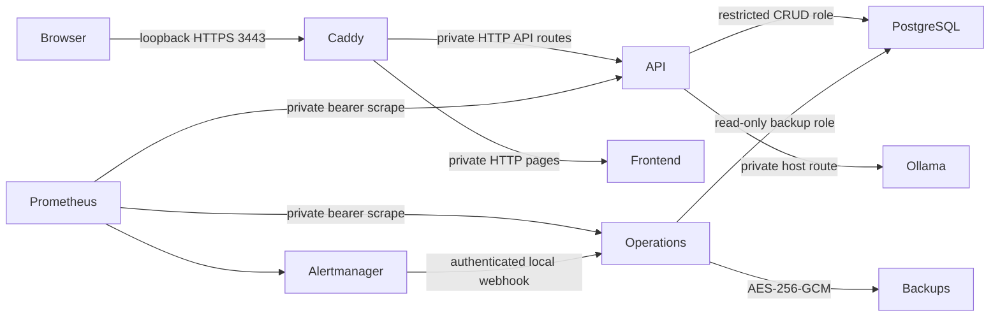

# Acceptance 005 local TLS staging

This deployment is an executed local production-like environment, not a public server.
It uses the independently built backend and frontend with the production Compose hardening,
a private database, a local CA, separate secrets and persistent volumes. The existing
`onesa-platform` development deployment and native Ollama remain independent.

## Inventory and boundaries

| Component | Actual local arrangement | Target-host prerequisite |
| --- | --- | --- |
| Host | Apple M3, 24 GiB unified memory, macOS 27.0.1, Docker Desktop Linux arm64 | Supported Linux Docker Engine/Compose with `!override`/`!reset`; qualify target resources |
| Browser ingress | Caddy internal-CA HTTPS, loopback 3443 | Owned DNS, publicly trusted certificate, firewall and host authorization |
| Frontend | Next.js production image, private 3000, non-root/read-only, 512 MiB/1 CPU | Independent immutable frontend release |
| Backend | FastAPI production image, private 8000, non-root/read-only, 1 GiB/2 CPUs, 128 PIDs | Independent immutable API release; compatible contract/schema |
| Database | PostgreSQL 16/pgvector, private 5432, isolated `postgres-data`, 2 GiB/2 CPUs | Encrypted durable storage, restricted owner/app/backup credentials |
| Inference | Mock for application capacity; installed native Ollama for separate real acceptance | Private qualified Ollama or NVIDIA/vLLM service; never publish inference ports |
| Documents | Extracted text, vectors, metadata and saved source excerpts in owned PostgreSQL rows | Retention/privacy decisions; original uploaded binaries are not retained |
| Metrics | Prometheus loopback 9095; private authenticated API/worker scrapes | Operator access control, retention, host/disk/GPU exporters where needed |
| Alerts | Alertmanager loopback 9096 to authenticated local operations receiver | Reviewed external on-call destination and actual delivery test |
| Backups | Hourly worker, encrypted `backups` volume, seven-day retention, private key | Independent off-host destination/key custody and target-scale restore |
| Operations | Authenticated worker loopback 9905, private `operations-state` | Restricted operator host; no anonymous administrative API |

The local production-style stack needs roughly 4 GiB application/database capacity plus
build overhead and inference memory; these are resource allocations, not a sizing guarantee.
The tested model’s reported loaded memory is recorded in the measured acceptance report. Main application, Docker builds and other local services share the host, so the
measurements are not dedicated-server capacity results.



Container-network traffic is private but not mutually TLS encrypted. Docker administrator
access remains privileged. Loopback Prometheus/Alertmanager consoles rely on trusted host
access; never bind them publicly. Native Ollama binds 127.0.0.1:11434 and Docker Desktop
provides the existing host route. No remote inference or external travel provider is used.

## Reproduce

Run from the repository root after `make install`. Docker must be available. Bootstrap
creates secrets once and refuses overwrite; it does not edit the developer `.env`.

```sh
python3 scripts/acceptance/bootstrap.py
docker compose --env-file data/acceptance-005/staging.env -p onesa-acceptance-005 \
  -f compose.yaml -f compose.production.yaml -f compose.acceptance.yaml up --build --wait --wait-timeout 240
docker compose --env-file data/acceptance-005/staging.env -p onesa-acceptance-005 \
  -f compose.yaml -f compose.production.yaml -f compose.acceptance.yaml \
  cp proxy:/data/caddy/pki/authorities/local/root.crt data/acceptance-005/staging-ca.crt
.venv/bin/python scripts/acceptance/tls_security.py
ONESA_LOCAL_TLS_TEST=1 ONESA_BROWSER_URL=https://localhost:3443 \
  npm --prefix onesa-ai-platform-frontend/apps/chat run test:e2e -- tests/chat.spec.ts
```

The Python TLS probe verifies the exported CA and hostname. Playwright's explicitly local
TLS flag bypasses its certificate trust only for this browser test. No system trust store
was changed; opening the site manually requires trusting this public test CA in a separate
test browser profile. Never copy or distribute the private CA key.

Startup order is DB readiness → owner migration → separate role provisioning → API readiness
→ frontend → proxy. Operations starts after role provisioning; monitoring scrapes periodically.
Migrations and provisioning are one-shot jobs. Document/source ownership lives in the DB.
Named volumes also retain Caddy CA state, metrics, alert state, encrypted backups and worker
status. `down` stops the stack; routine operation must not use `down -v`.

Capacity tests deliberately use a 1000/min socket-peer limit in this isolated fixture; the
normal default is 100/min, with a separate 10/min hashed-account limit. Production ingress
values need qualification for expected shared-proxy traffic. Password hashing is bounded to
four concurrent operations and ingestion to one parser, independently of request concurrency.

For real inference, add `-f compose.ollama.yaml` to the same command. Keep the native daemon
running. The guarded failure overlay routes only this staging API to a closed host port and
must be removed after testing; the daemon and main application are untouched. Native Ollama
has no bearer credential on this loopback path; the adapter omits an empty header. Private
vLLM requires its separately configured key.

A public deployment requires reviewed DNS/TLS/firewall, operator identities and secret custody,
external alert routing, off-host recovery, hardware/load acceptance, legal decisions and launch
authorization. Local PASS results do not satisfy those gates.
