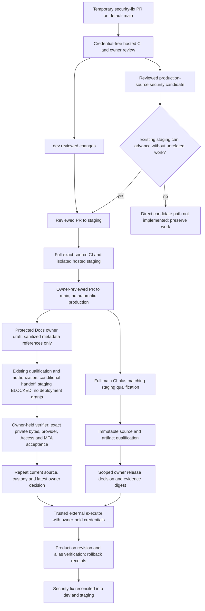

# CI/CD development and release workflow

Current policy: 2026-10-14. Keep three permanent branches: `dev`, `staging`, `main`.
Normal changes follow `dev → staging → main`. Temporary Dependabot security-fix PRs
and reviewed security release candidates are permitted. Preserve concurrent work,
data, existing approvals and rollback evidence. The dated
[pipeline audit](../development/CI_CD_PIPELINE_REPORT.md) records earlier measurements;
its inventory is not a current provider receipt.

## Development and dependency maintenance

Review normal changes on dev, promote reviewed source to staging, run full exact-source
CI and hosted acceptance, then merge qualified staging to main by owner-reviewed PR.
Main requires its own full CI and qualification; a dev or PR result cannot substitute.
Keep the default branch main. Dependabot security updates target the actual default
branch; `target-branch: dev` in version-update configuration does not retarget security
updates. Review the proposed fix and integrate it through dev → staging → main.

Ordinary version-update PR creation remains `open-pull-requests-limit: 0`. Retained
monthly schedules, version grouping and seven-day cooldown metadata do not enable
ordinary version PRs at that limit. Automated security fixes remain enabled separately.
The 2026-10-14 protected coordinator receipt verifies all three repositories have
`enabled: true`, `paused: false`, enabled alerts and zero open alerts at readback.
Owner notification delivery is owner-confirmed, separately from the API checks.
The 2026-10-14 12:31 UTC coordinator readback directly verified all three dependency
graph SBOM endpoints with HTTP 200; the earlier HTTP 404 observation remains in
historical evidence. At that readback, weekly scans were active on the Portal and
Robot default branches; the AI default branch still retained its earlier CI without
the schedule. Normal reviewed promotion to main activates the prepared AI schedule.
Do not claim source schedules are effective before that promotion or change unrelated
security settings.

Keep weekly full CI advisory, runtime-image, workflow and secret checks even when
application source has not changed. Bot PRs use the same credential-free hosted checks
and owner review; no blind auto-merge, production deployment secrets, `pull_request_target`
or additional permanent environment. Clean temporary branches only after verified
incorporation and review of artifact, evidence and rollback dependencies.

## Urgent security candidates

If dev contains unfinished work, construct a temporary candidate from exact current
production plus the reviewed security fix only. Qualify against the existing isolated
staging targets before owner-controlled production release, then reconcile the fix
into dev and staging. An allowed temporary branch is not itself a qualified release.

Current implementation accepts staging/main evidence, not arbitrary temporary branch
evidence. Manual `release-staging.yml` and the `deploy.yml` bridge require staging;
`checked_ci` requires exact-source push CI on staging/main. Production qualification
requires current main, an actual owner-merged PR, exact main CI and an exact matching
staging receipt. Hosted staging additionally verifies its existing provider identities,
database isolation and native staging Preview. These guards remain in force.

An urgent candidate can use this implementation when the existing staging branch can
advance to the candidate without incorporating unrelated work or discarding its tip.
After preliminary staging acceptance and the reviewed main PR, advance staging to the
exact resulting main commit without rewriting history, rerun full checks and hosted
staging acceptance, and qualify that exact main commit. Advancing main does not deploy
production: competing production Git auto-deploy must remain disabled. If staging has
unrelated unfinished commits, the direct temporary-candidate qualification path is
**not implemented**. Preserve those commits; report the guard limitation and implement
a separately reviewed candidate path before attempting this urgent release. Do not
reset staging, manufacture source-equivalence evidence, or relax provenance checks.

## Checks and trust boundary

Reviewdog consumes existing ESLint, Ruff, mypy and TypeScript diagnostics as read-only
Actions annotations. Original analyzer failures block independently. The existing
offline actionlint/Zizmor/Gitleaks checks, npm/pip advisory checks and Trivy runtime
HIGH/CRITICAL and secret gates remain active. Locks and action commit pins live in
source; use the actual lockfiles rather than this runbook as a version authority.
Semgrep and a hosted AI review service are not enabled or required.

PR path selection retains affected tests/builds; unknown/shared/security changes fail
closed to full coverage. Pushes on dev/staging/main and the weekly schedule run full
critical checks. Required AI jobs include backend, frontend, browser, documentation,
containers, TLS acceptance, both image-security jobs, workflow-security and ci-summary;
independent publication hygiene is also required. Missing/skipped/cancelled mandatory
jobs or failing required steps invalidate qualification. Runtime records bind tested
image digests; mock/local-model tests do not qualify actual hosted inference.

Untrusted PR checks run on disposable GitHub-hosted runners with read-only tokens and
no provider credentials. The local runner implementation is removed; hosted validation retains isolated
execution and the included private allowance is checked before enabling jobs. Cache only dependency downloads keyed by lockfiles, never credentials,
private data or deployment artifacts. Cancel superseded PR checks, preserve release
runs and deployment receipts, and measure actual account usage before claiming savings.

## Staging, qualification and owner release

After reviewed staging source and its full CI pass, the registered owner command is
`gh workflow run deploy.yml --ref staging -f target=staging -f fixture_mode=temporary`.
It calls the same `release-staging.yml` with only named staging secrets. Vercel owns
the protected exact-source native staging Preview; Actions verifies it and deploys the
exact backend revision to the approved isolated Render target. Temporary synthetic
identities use private credentials and bounded grants; run-specific cleanup revokes
their sessions. Never use production identities or destructive production tests.

Automatic staging remains opt-in, private-only and owner-only. It accepts successful
push-to-main CI at current main, requires staging at the same commit and verifies full
CI before exposing scoped staging credentials. A failed preflight needs a fresh owner
dispatch after prerequisites pass; no open-ended retry or alternate deploy authority.

`free-qualification.yml` on main consumes an exact successful staging run and verifies
repository/owner/run provenance, source hash, image/artifact digests and hosted checks.
It has no provider secrets. `free-authorization.yml` on main defaults to revoke;
approve requires the exact qualification run and evidence digest. An optional existing
owner review issue binds additional reviewed scope; otherwise the exact owner dispatch
records the decision. Technical qualification records operations and content/legal
limitations explicitly. A green producer or handoff artifact does not convert blocked
scope into a full G01–G32 PASS or authorize public registration, real data or hardware.

Independent Docs delivery uses the same workflows with an explicit
`delivery_scope=docs-public` or `docs-internal`. The default remains `full`; an
ambient `DELIVERY_SCOPE` never changes an external verifier's default. A Docs
authorization cannot release the AI frontend or API. Its exact-source owner Docs
Preview, classified archive and production-context acceptance replace only the
application staging requirement for public Docs. Full main CI, owner review,
freshness, artifact provenance and latest revocation checks still apply.

Protected Docs uses an explicit conditional channel in these existing workflows.
Qualification requires the immutable ID of an owner-created draft release, its
single owner-uploaded `protected-docs-preview-qualification.json` asset ID and
`sha256:` digest, and the reviewed producer hash. The asset is bounded to 64 KiB
and contains only exact source/CI/provider references, counts, hashes and false
deployment grants. Private HTML, PDFs, diagrams, identity claims and credentials
remain outside GitHub artifacts. The draft remains unpublished.

The internal qualification and owner authorization keep `STAGING_VERIFIED=BLOCKED`
and all production, application and backend deployment grants false. External
`verify --delivery-scope docs-internal --metadata-producer-sha256 <reviewed-hash>`
requires the producer pin independently retained by the owner executor; metadata
cannot choose this trust anchor. Its result is `CONDITIONAL_EXTERNAL_HANDOFF` with
`conditional_authority=REQUIRES_EXTERNAL_LIVE_VALIDATION`. Public and full consumers
reject this result. Before any private production write, the owner executor must
independently verify current exact main CI/source, both classified private trees
and archives with their actual acceptance, the actual Pages Preview/source,
approved engineering session and current MFA policies, all four Access bindings,
all-path denials, actual private asset/PDF/diagram bytes and retained application/API
controls. It repeats custody/latest-authorization checks immediately before delivery
and performs protected hosted acceptance afterwards. A metadata record alone grants
no production action and cannot establish private hosted PASS.

Public Docs Preview can also use the explicit `native-owner` validation channel
when the existing Preview is protected by Vercel SSO. The registered owner
`docs-hosting.yml` producer still requires exact staging/main source and full CI,
both immutable public archives, typed local staging/production acceptance and the
actual READY Preview identity. It records hosted acceptance as
`PENDING_NATIVE_OWNER`, public scope as `BLOCKED`, and requests no production
deployment. A successful workflow carrying this pending record is not hosted PASS.
The normal public channel, full application gate and protected channel remain strict.

The owner-held read-only native producer verifies that pending record and actual
archive bytes, then runs all hosted checks in the existing approved browser session
without copying cookies, credentials or profile state. Its sanitized metadata binds
exact source/CI, producer hash, Preview identity, registered record, both archive
IDs/hashes, tree hashes and acceptance hash/counts. The existing qualification
accepts the explicit `native_custody_mode=actions-native` and `native_metadata`
dispatch inputs for public Docs only. It parses at most 32 KiB of count/hash-only JSON
from `GITHUB_EVENT_PATH`, without shell interpolation, and rejects duplicate or
nonfinite values, extra fields, mixed draft custody, caller PASS or true grants.
The current owner/main workflow independently checks source, full main CI, Preview
identity and both actual archives before retaining this metadata in the existing
immutable `free-release-qualification` artifact. Its API digest, workflow run and
exact record are checked again by authorization and the external reader; no new
permission or artifact system is introduced. Metadata is custody only.

Explicit public metadata custody selects only the conditional channel. Public
conditional authorization and external verification require the independently held
producer pin; absent custody/pin retains the normal strict public gate. The result
is `CONDITIONAL_EXTERNAL_HANDOFF`, `REQUIRES_EXTERNAL_LIVE_VALIDATION`, staging
`BLOCKED` and false application, backend and production grants. Default/full,
protected and existing normal public consumers reject this conditional result.
The native source proof ends with owner production review still required. No new
publisher hook or production CLI is authorized by this source change. Any later
reviewed executor must independently repeat native hosted acceptance, exact
source/artifact/provider binding, retained application/API and no-auto-production
controls, latest owner authority and post-release acceptance before claiming delivery.

This path creates no second Preview bypass key, new workflow, service credential or
GitHub permission. The public owner-draft alternative remains fail-closed: the
one-shot 2026-10-14 main diagnostic `38616543571` failed with API unavailable and
zero artifacts, rather than the expected schema rejection. The exact failed API
endpoint and permission cause were not recorded. Do not retry, publish that draft,
or expand permissions to infer capability. The existing Actions artifact channel
already supports qualification uploads and authenticated reads; this native
metadata mode still requires actual exact-source workflow and live validation.
Pre-main native review can inspect a source-bound Preview but cannot qualify a
future main SHA; conditional qualification requires current exact main and full CI.

Workflow permissions remain `contents: read`. Actual read-only `GITHUB_TOKEN`
visibility of the owner draft and asset must be verified on the real approved
metadata; synthetic tests do not prove it. GitHub documents [draft release listing
restrictions](https://docs.github.com/en/rest/releases/releases#list-releases) and
[release-asset read permissions](https://docs.github.com/en/rest/releases/assets#get-a-release-asset).
An unavailable draft fails closed. Do not add credentials or write permissions,
publish the draft, or substitute caller JSON to bypass this condition.

Dispatch public Docs Preview with `gh workflow run docs-hosting.yml --ref staging
-f target=preview`. This workflow prepares its pinned CLI before deployment
credentials, publishes a Preview only, and uploads separate accepted staging and
production-context public archives. The external publisher consumes the qualified
production archive rather than rebuilding ignored local output. It verifies that
the canonical AI application and API still serve the retained qualified revision
and that automatic main production delivery is disabled. Protected Docs needs its
own actual all-path Access, approved engineering identity and MFA acceptance; a
local fixture or public Docs approval does not satisfy that requirement.

Public Docs Preview acceptance uses a separately owner-managed Vercel automation
bypass credential for the dedicated Docs project while its Vercel Authentication
configuration remains enabled. The owner creates and reviews this credential;
the workflow only reads the named existing entry and removes its private runner
file after use. Its provider reach covers all deployments of that public Docs
project until revoked and includes some bot and system mitigation bypasses. The
test sends it only to the exact verified Preview origin. Authenticated fetches
refuse redirects; browser navigation can continue without that header to an
external destination. The credential never enters URLs, logs, cookies or public
artifacts. Revoke
only the newly owned entry after the required qualification previews, preserving
existing credentials. This mechanism does not apply to protected engineering
Docs, the AI application or its API.

Run `scripts/release/free_gate.py verify` from a clean independently reviewed exact-main
checkout outside repository Actions using owner GitHub authentication. Latest revocation,
failed/pending authorization, stale evidence, main movement or changed review invalidates
the handoff. Production credentials stay in owner-controlled external custody; only
the qualified executor releases the exact authorized source. Confirm provider revision,
aliases, readiness, authenticated workflows, actual inference/embeddings, monitoring and
compatible rollback. Retained native-production workflows require verified supported
protection; they cannot bypass the external custody boundary.

GitHub Free operating discipline is not server-side protection against a write-authorized
user changing workflows or pushing main. Reverify actual repository visibility, token
permissions, plan/protection and provider controls. Render automatic deployment/hooks
and Vercel competing production deployment paths must remain disabled. Local configuration
files are intent; protected provider readback is evidence. Preserve separate public and
Access-protected documentation releases. Robot simulation, edge distribution and physical
hardware authorization remain outside AI Platform release scope.

See [deployment](DEPLOYMENT.md), [private-Free safeguards](../development/PRIVATE_FREE_SAFEGUARDS.md)
and the protected release register for current source-specific operational evidence.

### Missing automatic CI event

If GitHub records no push run for the exact staging/main candidate, the owner may
dispatch the existing full CI and repository-hygiene workflows at that unchanged
permanent-branch revision. Record the actual `workflow_dispatch` run IDs; never
label them as push runs. The verifier requires the exact source, workflow, repository,
owner actor/triggering actor, first attempt and every required job/security step.
An existing failed, pending, skipped or cancelled push cannot be replaced this way.
PR checks and local results alone remain insufficient; no test or production gate
is bypassed. Missing checks still block until the full dispatched jobs pass.
