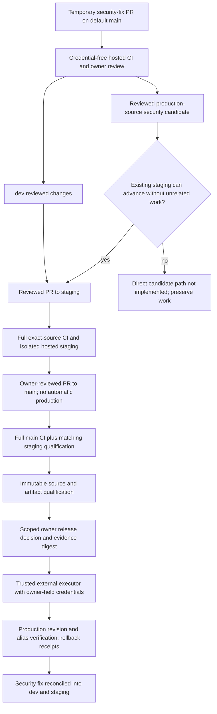

# CI/CD development and release workflow

Current policy: 2026-10-14. Keep three permanent branches: `dev`, `staging`, `main`.
Normal changes follow `dev → staging → main`. Temporary Dependabot security-fix PRs
and reviewed security release candidates are permitted. Preserve concurrent work,
data, existing approvals and rollback evidence. The dated
[pipeline audit](../development/CI_CD_PIPELINE_REPORT.md) records earlier measurements;
its inventory is not a current provider receipt.

## Development and dependency maintenance

Review normal changes on dev, promote reviewed source to staging, run full exact-source
CI and hosted acceptance, then merge qualified staging to main by owner-reviewed PR.
Main requires its own full CI and qualification; a dev or PR result cannot substitute.
Keep the default branch main. Dependabot security updates target the actual default
branch; `target-branch: dev` in version-update configuration does not retarget security
updates. Review the proposed fix and integrate it through dev → staging → main.

Ordinary version-update PR creation remains `open-pull-requests-limit: 0`. Retained
monthly schedules, version grouping and seven-day cooldown metadata do not enable
ordinary version PRs at that limit. Automated security fixes remain enabled separately.
The 2026-10-14 protected coordinator receipt verifies all three repositories have
`enabled: true`, `paused: false`, enabled alerts and zero open alerts at readback.
Owner notification delivery is owner-confirmed, separately from the API checks. The
dependency-graph SBOM endpoint returned 404 and was not directly verified; do not
describe that response as a disabled graph or change unrelated security settings.

Keep weekly full CI advisory, runtime-image, workflow and secret checks even when
application source has not changed. Bot PRs use the same credential-free hosted checks
and owner review; no blind auto-merge, production deployment secrets, `pull_request_target`
or additional permanent environment. Clean temporary branches only after verified
incorporation and review of artifact, evidence and rollback dependencies.

## Urgent security candidates

If dev contains unfinished work, construct a temporary candidate from exact current
production plus the reviewed security fix only. Qualify against the existing isolated
staging targets before owner-controlled production release, then reconcile the fix
into dev and staging. An allowed temporary branch is not itself a qualified release.

Current implementation accepts staging/main evidence, not arbitrary temporary branch
evidence. Manual `release-staging.yml` and the `deploy.yml` bridge require staging;
`checked_ci` requires exact-source push CI on staging/main. Production qualification
requires current main, an actual owner-merged PR, exact main CI and an exact matching
staging receipt. Hosted staging additionally verifies its existing provider identities,
database isolation and native staging Preview. These guards remain in force.

An urgent candidate can use this implementation when the existing staging branch can
advance to the candidate without incorporating unrelated work or discarding its tip.
After preliminary staging acceptance and the reviewed main PR, advance staging to the
exact resulting main commit without rewriting history, rerun full checks and hosted
staging acceptance, and qualify that exact main commit. Advancing main does not deploy
production: competing production Git auto-deploy must remain disabled. If staging has
unrelated unfinished commits, the direct temporary-candidate qualification path is
**not implemented**. Preserve those commits; report the guard limitation and implement
a separately reviewed candidate path before attempting this urgent release. Do not
reset staging, manufacture source-equivalence evidence, or relax provenance checks.

## Checks and trust boundary

Reviewdog consumes existing ESLint, Ruff, mypy and TypeScript diagnostics as read-only
Actions annotations. Original analyzer failures block independently. The existing
offline actionlint/Zizmor/Gitleaks checks, npm/pip advisory checks and Trivy runtime
HIGH/CRITICAL and secret gates remain active. Locks and action commit pins live in
source; use the actual lockfiles rather than this runbook as a version authority.
Semgrep and a hosted AI review service are not enabled or required.

PR path selection retains affected tests/builds; unknown/shared/security changes fail
closed to full coverage. Pushes on dev/staging/main and the weekly schedule run full
critical checks. Required AI jobs include backend, frontend, browser, documentation,
containers, TLS acceptance, both image-security jobs, workflow-security and ci-summary;
independent publication hygiene is also required. Missing/skipped/cancelled mandatory
jobs or failing required steps invalidate qualification. Runtime records bind tested
image digests; mock/local-model tests do not qualify actual hosted inference.

Untrusted PR checks run on disposable GitHub-hosted runners with read-only tokens and
no provider credentials. The local runner remains dormant/private-only until isolation
is verified. Cache only dependency downloads keyed by lockfiles, never credentials,
private data or deployment artifacts. Cancel superseded PR checks, preserve release
runs and deployment receipts, and measure actual account usage before claiming savings.

## Staging, qualification and owner release

After reviewed staging source and its full CI pass, the registered owner command is
`gh workflow run deploy.yml --ref staging -f target=staging -f fixture_mode=temporary`.
It calls the same `release-staging.yml` with only named staging secrets. Vercel owns
the protected exact-source native staging Preview; Actions verifies it and deploys the
exact backend revision to the approved isolated Render target. Temporary synthetic
identities use private credentials and bounded grants; run-specific cleanup revokes
their sessions. Never use production identities or destructive production tests.

Automatic staging remains opt-in, private-only and owner-only. It accepts successful
push-to-main CI at current main, requires staging at the same commit and verifies full
CI before exposing scoped staging credentials. A failed preflight needs a fresh owner
dispatch after prerequisites pass; no open-ended retry or alternate deploy authority.

`free-qualification.yml` on main consumes an exact successful staging run and verifies
repository/owner/run provenance, source hash, image/artifact digests and hosted checks.
It has no provider secrets. `free-authorization.yml` on main defaults to revoke;
approve requires the exact qualification run and evidence digest. An optional existing
owner review issue binds additional reviewed scope; otherwise the exact owner dispatch
records the decision. Technical qualification records operations and content/legal
limitations explicitly. A green producer or handoff artifact does not convert blocked
scope into a full G01–G32 PASS or authorize public registration, real data or hardware.

Run `scripts/release/free_gate.py verify` from a clean independently reviewed exact-main
checkout outside repository Actions using owner GitHub authentication. Latest revocation,
failed/pending authorization, stale evidence, main movement or changed review invalidates
the handoff. Production credentials stay in owner-controlled external custody; only
the qualified executor releases the exact authorized source. Confirm provider revision,
aliases, readiness, authenticated workflows, actual inference/embeddings, monitoring and
compatible rollback. Retained native-production workflows require verified supported
protection; they cannot bypass the external custody boundary.

GitHub Free operating discipline is not server-side protection against a write-authorized
user changing workflows or pushing main. Reverify actual repository visibility, token
permissions, plan/protection and provider controls. Render automatic deployment/hooks
and Vercel competing production deployment paths must remain disabled. Local configuration
files are intent; protected provider readback is evidence. Preserve separate public and
Access-protected documentation releases. Robot simulation, edge distribution and physical
hardware authorization remain outside AI Platform release scope.

See [deployment](DEPLOYMENT.md), [private-Free safeguards](../development/PRIVATE_FREE_SAFEGUARDS.md)
and the protected release register for current source-specific operational evidence.
