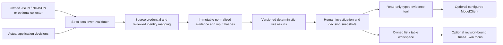

# Independent Cybersecurity workspace

Classification: INTERNAL engineering reference. Source implementation and local
synthetic acceptance are separate from staging qualification, production activation,
live OT acceptance, external consumer acceptance and independent security review.
No certification, malware detection, complete SIEM/EDR coverage or compliance rating
is asserted. The broader Applications and Industrial AI product hierarchy is retained.

## Audit and capability matrix

The October 26 audit inspected maintained branches and open PRs in
`DruHustle/onesa-ai-platform`. At audit baseline `7723324`, FastAPI registered
Industrial Investigation and Digital Twins but no dedicated cybersecurity router,
domain records or workspace. Open PRs were dependency updates. Concurrent Twin,
private persistence and owner release-runner changes were preserved. The dedicated
module described here is new implementation, rather than an existing deployed module.

Portal source `src/components/product-overview.tsx` explicitly describes application
security as a **planned development direction**. Its proposed code review, threat
modelling and vulnerability triage do not establish a monitoring product. Product,
technology and Industrial source did not supply a verified existing cybersecurity
workspace. Public website reads were unavailable during this audit; published managed
content remains unverified. Do not infer that unavailable content is absent.

| Claim | Backend / persistent records | Actual UI and event source | Permission / tests | Hosted acceptance / gap |
| --- | --- | --- | --- | --- |
| Security evidence and asset posture | `cybersecurity`, `cyber_service`, owned sources/assets/mappings/events/reports | Native `/industrial/cybersecurity`; reviewed JSON/NDJSON imports and scoped collector | Owner/session or separate source credential; real database and gateway browser tests | New module is default-off; no live OT connector acceptance |
| Deterministic findings | Versioned policies/baselines/findings and immutable result snapshots | Findings link to source, reviewed asset, typed observations and rule explanation | Current owner; global native records require configured security operator; window/mode/concurrency tests | Exact-source hosted release still required |
| Investigation workflow | Investigations, action history, expiring risk decisions and saved summaries | Create, acknowledge, investigate, note, resolve with evidence, dismiss with reason, accept risk, reopen, reload | Current owner; no invented second approver or enterprise membership | No autonomous remediation or incident closure |
| Real application evidence | Post-decision native authentication/authorization evidence; post-commit owned policy evidence | Real rejected login and privileged administration paths; sanitized references only | Explicit server operator UUIDs for global events; ordinary owners see only their committed configuration changes | No usernames/passwords/tokens or global ordinary-user access |
| Vulnerability triage | Offline CycloneDX 1.6 flat inventory/advisory snapshot and original input hash | Reviewed asset inventory import; reported advisory matches and unknown-version candidates | Owner and reviewed source mapping; malformed/cross-scope report tests | No official feed required; no verified exploitability or firmware attestation |
| Optional AI assistance | Typed read-only tool and immutable report context/checksum | Deterministic checklist without inference; explicitly configured model drafts cited hypotheses | Session/grants rechecked, provider capacity retained, data policy default-off; mock grounding tests | No new provider enabled or paid call authorized; real-provider acceptance remains separate |
| Optional Twin context | Explicit owned installed-asset/component mapping, bound revision | Asset link and optional highlight/focus in Onesa's own viewer | Both sides authorize reads; stale mapping cannot focus a component | Core lists/investigations need no model, WebGL or enabled Twins |
| AI code review and threat modelling | Not delivered by this module | Portal still labels these as planned application directions | No claim of implementation from TLS, CI scanning or this workspace | Future product scope; do not mark these claims fulfilled |

No public Portal patch is required to remove an availability claim in the examined
source, because it already says planned. If editorial wording is updated, precise
copy is:

- EN: “Cybersecurity is in development: reviewed security evidence, asset posture
  and human investigations. Production availability and live OT connections require
  separate qualification. AI-assisted code review and threat modelling remain planned.”
- DE: „Cybersicherheit ist in Entwicklung: geprüfte Sicherheitsbelege, der
  Sicherheitszustand von Anlagen und menschlich geführte Untersuchungen.
  Produktionsverfügbarkeit und Live-OT-Anbindungen erfordern eine separate
  Qualifizierung. KI-gestützte Code-Reviews und Bedrohungsmodellierung bleiben geplant.“
- Existing public target: `/en/products#application-security` or
  `/de/products#application-security`; product contact remains the existing
  `/{locale}/contact?topic=application-security`. A workspace link targets
  `/industrial/cybersecurity` only on an enabled, qualified AI deployment.
  Publication and legal controls remain independent; this text is not published copy.

## Architecture and authority



FastAPI, PostgreSQL/Alembic and Next.js remain the existing independent platform.
There is no peer SDK, shared custom schema/viewer package, Smart Factory login,
peer database/bucket/API, external feed, broker, Redis, Kubernetes, GPU or model
prerequisite. No active discovery, network probing, packet capture, PLC/machine write,
quarantine, firewall change, patch/firmware deployment, arbitrary command or credential
rotation is implemented. Imported endpoint references never cause a server URL fetch.

All domain records use existing `users` ownership; this is not a new tenant or
organization model. Current invitations, active-account status, session revocation,
Origin/CSRF and server-configured access remain authoritative. No payload email,
owner/tenant/site field, external identifier or UUID grants authority. Aggregate,
search, export, report, investigation, tool and optional Twin reads remain scoped.

| Operation | Authority |
| --- | --- |
| Owned assets, mappings, imports, policies and investigations | Current authenticated owner; mutations require existing Origin/CSRF |
| Collector ingestion | Separate source credential, server-bound owner/namespace/modes; no retrieval or administration permission |
| Global native authentication/authorization evidence | Explicit `ONESA_CYBERSECURITY_OPERATOR_USER_IDS`, active eligible configured account; never email matching or self-grant |
| Native owned configuration evidence | Actual committed owner action; cannot be impersonated by external input |
| Knowledge guidance and generated summaries | Current owned document and investigation authorization; no embeddings as the source of live findings |
| Optional installed-component focus | Owned Twin plus explicit reviewed mapping and unchanged asset/model revision |

Source credentials are displayed once, retained only as hashes by the server, and
excluded from list/detail/export/log output. The browser stores no source token in
localStorage, cookies or URLs. Revocation and ingestion serialize on the same owner
and source transaction locks, with authority refreshed after waiting.

## Configuration and migration

Server-only defaults:

| Key | Default | Meaning |
| --- | --- | --- |
| `ONESA_CYBERSECURITY_ENABLED` | `false` | Enable only the cybersecurity routes after additive schema installation |
| `ONESA_CYBERSECURITY_DEMO_ENABLED` | `false` | Allow explicit simulated/replay demonstrations outside production |
| `ONESA_CYBERSECURITY_AI_ENABLED` | `false` | Permit optional assistance only after the existing data policy permits configured inference |
| `ONESA_CYBERSECURITY_OPERATOR_USER_IDS` | `[]` | Canonical user UUIDs installed through reviewed server configuration; first eligible configured account receives global native evidence |

Migration `20261026_cybersecurity` follows `20261025_twins`, adds twelve indexed
domain tables, and modifies no existing application data. It does not seed accounts,
events, incidents or credentials. The owner-run migration command accepts an explicit
reviewed target and grants only DML on the nine preceding Industrial/Twin tables plus
the twelve cybersecurity tables for this target. Runtime CREATE, migration-table
writes, ownership and role escalation remain forbidden. Legacy migration targets
remain explicit; a newer schema is never silently downgraded or relabelled.
Coordinated backups read the exact Alembic revision from the same immutable dump;
the existence of Twin tables does not imply that the database is still at the Twin head.

Core readiness and the disabled-feature rollback remain compatible with the preceding
capacity/Industrial/Twin schemas. Cybersecurity has separate authenticated readiness;
a missing optional schema does not make Chat, Knowledge or disabled Twins unavailable.
Rollback disables the feature while retaining additive tables, evidence and decisions;
the downgrade refuses destructive erasure. Existing encrypted database snapshots cover
these PostgreSQL records; this module adds no binary/object storage dependency.

Local isolated demonstration, after ordinary private bootstrap:

```sh
docker compose -p onesa-security-demo -f compose.yaml -f compose.cybersecurity-demo.yaml up --build --wait
```

Use its dedicated local database/port and explicitly create a synthetic account.
The overlay needs no Twin or peer service. Import through Sources, or invoke the
authenticated `/api/v1/cybersecurity/demo` with `mode` `simulated` or `replay` and
a nonblank `run_id`. Demonstrations are never seeded at startup and production
configuration rejects them. The same run is idempotent; replay has separate identities.
To observe native global decisions in an isolated test, explicitly configure the
synthetic operator's actual UUID on that isolated API, restart it, and exercise the
real login/administration path. Never use customer credentials or a production account.

## Wire contract and imports

The independently implemented optional interchange profile is
`ot-security-evidence/v1`. JSON is exactly `{"events":[EVENT,...]}`; NDJSON is
one event per line. HTTP body ceiling is 1,048,576 bytes, at most 100 events and
8,192 normalized UTF-8 bytes per event; NDJSON lines also have that byte ceiling.
JSON nesting is at most twelve levels. Duplicate keys, nonfinite values, unknown
fields/types/versions, implicit coercion, impossible dates and non-UTC timestamps
are rejected before detection. UTF-8 identifiers and string/array bounds are enforced.

Required fields are `schemaVersion`, `producerNamespace`, `sourceEventId`,
`occurredAt`, `mode`, `eventType`, `assetRef`, `summary`, `quality`,
`producerVersion`, `attributes`. Required nullable `assetRef` and `componentId`
remain explicit; absent optional context is omitted. UTC accepts `Z` or `+00:00`.
Simulated evidence requires `scenarioRunId`; replay requires `replayRunId`.
Optional `producerReceivedAt`, `sessionId`, safe nonnegative `sequence` and
`correlationId` are bounded context, not attestation. Sequence is producer-local within its declared session; it does not override receiver timestamps, authorize an identity or reset immutable event-ID uniqueness. Correlation IDs only group declared context. The receiver controls
source identity and `created_at` ingestion time. Received and redacted stored-content
hashes are separate. Credential-like identifiers and URI references with credentials/query/fragment are rejected. Credential-free opaque URI references are preserved and never fetched; inert free text is redacted. Imported content never becomes an instruction.

| Event type | Strict attribute profile |
| --- | --- |
| `auth.authentication_failed`, `auth.authorization_denied` | `service`, rejected `outcome`, `reasonCode`, optional pseudonymous `principalRef` |
| `tls.certificate_observed` | Configured `endpointRef`, real `notBefore` / `notAfter`, lowercase SHA-256 fingerprint |
| `config.changed`, `config.drift_observed` | `configRevision`, optional `baselineRevision`, at most 32 `changedKeys`; no values/secrets |
| `identity.unrecognized` | `inputRef`, `observedIdentityRef`; finding requires a reviewed input/allowlist |
| `collector.health` | `state` online/offline/degraded/paused, optional positive bounded `expectedIntervalSeconds` |
| `software.inventory_observed` | `inventoryRef`, `sha256`; reference must resolve to a separately validated owned report with matching source/asset/hash |
| `integrity.change_observed` | Two SHA-256 values and explicit self-reported/collector-observed/verified-artifact label; label does not establish attestation |

The current OpenAPI snapshot/client contracts derive from this local validator.
See `app/cyber_schemas.py`, the documented request bodies and synthetic tests for
complete field bounds. No shared schema package, peer checkout or peer fixture release
is used. `assetRef` resolves only through an immutable reviewed source mapping; new
identity or ownership assumptions require another explicit review. Legacy/unknown
provenance cannot be exported as silently verified source evidence.

Identical source/event IDs and content are idempotent, including concurrent retries.
Different content conflicts; the entire batch rolls back. Event-time windows separate
source, asset, service, mode and scenario/replay run. Windows are start-exclusive and
end-inclusive; late data is accepted within 90 days, future skew up to five minutes
is recorded, and older/further-future data is rejected. Expired/bad-quality evidence
remains inspectable and cannot silently become current good evidence.

Offline inventory import supports the explicitly bounded **CycloneDX 1.6 flat/1**
subset: `bomFormat`, `specVersion`, positive `version`, optional UUID `serialNumber`,
`metadata.timestamp`, `metadata.tools.components` with tool name/version, up to 250
flat components and 100 vulnerabilities. Component fields are type, `bom-ref`, name,
optional version/group/purl. Vulnerabilities support id, optional source name,
at most five ratings (severity, score, method), affected local `ref` values, and bounded
description. Every reference resolves within the report. The body ceiling is 2 MiB.
Unsupported profiles/fields receive a preparation message; this is not a full arbitrary
SBOM parser. Original input SHA-256, producer/version, import time, report snapshot,
source/mode/run and matching method are retained. Unversioned inventory is an
unconfirmed applicability candidate, not a verified affected firmware instance.
The browser uploads the selected file's original bytes, preserving whitespace and
its input checksum; the import receipt and persisted posture inspector show that hash.
CVSS/advisory severity, local priority and verified exploitability remain separate.
There is no external catalog freshness or empty-feed claim.

## Rules, investigations, limits and retention

Rules are versioned declarative settings, never uploaded SQL, regex or executable code.
Defaults are five failed authentications or three authorization denials in 300 seconds,
and a thirty-day certificate warning. Actual privileged administration denials receive
their own finding. Configuration drift requires reviewed relevant keys and an accepted
revision; unknown identities require a reviewed allowlist and input scope. Collector
health/loss describes coverage only. `POST /assess` explicitly evaluates receiver
freshness and retained certificate metadata; a lack of delivery is not an attack.

Finding priority is severity base 10/20/40/60 plus reviewed asset criticality 0/10/20,
capped at 100. It is triage guidance, not a security score or certification. Coverage reports eight evidence families per reviewed asset, its actual denominator, selected mode, receiver delivery window and unknown/stale states. Assessed means eligible evidence exists; it does not mean a control passed. Source delivery and declared collector health remain separate.
Closing an investigation does not clear a still-observed finding. Risk acceptance
requires a reason and UTC expiry within thirty days; expiry remains visible. Revision
checks reject concurrent stale decisions. Original snapshots, all immutable event
checksum references, earlier rule results and human decisions remain inspectable.

Per owner: at most 100 assets, 30 configured sources (native sources are separately
bounded), 200 mappings/policies, 100 baselines/investigations/summaries, 2,000 events,
300 findings, 600 result snapshots, 1,000 audit actions and 20 reports. Full evidence
samples in findings have a 12 KiB budget plus checksum references to all bounded
inputs. Findings, decisions and investigation snapshots have separate byte ceilings;
the read-only tool has a 16 KiB fact budget. Limits apply transactionally; backpressure
does not delete evidence or authorize a larger paid service.

Thirty-day evidence expiry describes detection freshness, **not automatic deletion**.
Existing retention/legal decisions remain deferred; no production retention job is
enabled. Records stay bounded and account deletion cascades owned live data. Account
export includes owned cybersecurity data while disabled, excludes credentials/global
operator records, and retains existing self-service size limits. Larger exports use
the existing private support process. Existing backup retention and delayed backup
erasure remain separate. Database snapshots are append-only through this application,
not tamper-proof against infrastructure administrators.

Optional collector: `python -m app.cyber_collector --config /private/path/collector.json`.
The mode-0600 owner-only JSON contains exactly `endpoint` (explicit HTTPS ingestion
URL), `token_file` (private scoped credential file) and `outbox` (mode-0700 directory).
No secret belongs in arguments, browser storage, URLs or logs. Drain at most five
bounded `.json`/`.ndjson` files with a single local lock and three bounded attempts.
Transient outage/backpressure retains pending data; permanent rejection quarantines
it rather than retrying forever. Interrupted acknowledgement/archive can safely resend
the identical immutable IDs. Successful acknowledgements must account for every submitted event,
with nonnegative inserted/duplicate counts and unique canonical receiver IDs for
new records. Incomplete acknowledgements retain the pending batch for bounded retry.
Accepted/rejected private archives count against the 128-file/8-MiB cap; inspect
and apply an approved local retention decision before
requeuing or extending capacity. There is no default scheduler or endpoint discovery.

## Verification and release boundary

Meaningful regression suites are `tests/test_cybersecurity.py`,
`tests/test_cyber_collector.py`, migration tests and
`apps/chat/tests/cybersecurity.spec.ts`. They cover actual decisions/imports,
transactions/retries/mode/window edges, hostile content, owner/operator isolation,
revocation, snapshots/lifecycle, account privacy, provider grounding, durable outage
recovery and rendered responsive workflows. Existing platform suites remain mandatory.
Test targets must be disposable `_test` databases; test accounts are synthetic.

Use normal dev → staging → main, exact-source mandatory CI/contracts/dependency and
image checks, the separately commissioned pinned external owner verifier, fresh
isolated hosted staging records and current one-use authorization before deployment.
Changed source requires fresh records. Production verification must observe actual
source/artifact identities and affected journeys. Source/PR/local test success is not
deployment acceptance. Missing migration-owner custody must use the installed pinned
hidden-TTY custody command after all other preparation; never send secrets in chat,
borrow a peer's database role, bypass the verifier or treat an unsigned JSON as approval.

The existing Oracle runner now has an explicit `cybersecurity` mode. This is a new
extension of the owner-run path, not a previously commissioned service. It requires
schema `20261026_cybersecurity`, retains other feature flags, leaves demo/model
assistance and global operator expansion disabled, and uses
`scripts/release/oracle_cybersecurity_ui.cjs` inside the commissioned probe image.
Two newly created fixture owners exercise scoped bearer ingestion, idempotence,
mapped findings, a real committed configuration observation, acknowledgement,
deterministic report, revocation, export and ownership isolation. Staging also
renders/reloads the native workspace, restores only those owners' cybersecurity
rows through an offline encrypted dump/restore, and replaces the staging container
once before checking persisted sessions and decisions. Production API verification
and frontend rendering remain separate component checks. Genuine Actions run IDs
remain CI references; owner-run receipts retain run ID `0` and are not authorization.
Installation, separate trust commissioning and fresh signed contexts remain required.

Workspace lists contain bounded metadata; authorized detail endpoints return full
snapshots. Event and JSON/NDJSON export pages contain at most 100 events with a
scoped cursor. Coverage counts eight evidence families per reviewed asset, keeping
unknown and stale separate. Evidence quality, expiry, source revocation and delivery
freshness affect coverage; a complete denominator does not establish security.

Local acceptance on October 26 observed 496 passing backend tests and four explicit
local platform/provider skips before the final targeted regressions. The final focused
security/collector suite passed 80 tests; ten Chromium/WebKit journeys include original
inventory-file hashes, persisted posture, mobile themes, inert hostile text and optional
installed-component Twin focus. A later Linux CI backend run observed 499 passes and
three explicit provider/service skips at `8348c5b`; this is historical after further fixes.
These observations are not current-source CI, Linux seccomp, real provider, hosted,
production, live OT or Smart Factory consumer acceptance. Release evidence records
subsequent results against their exact source rather than transferring this statement.

Engineering references: [NIST SP 800-82r3](https://csrc.nist.gov/pubs/sp/800/82/r3/final),
[CISA asset inventory guidance](https://www.cisa.gov/resources-tools/resources/foundations-ot-cybersecurity-asset-inventory-guidance-owners-and-operators)
and the [official CycloneDX 1.6 schema](https://github.com/CycloneDX/specification/blob/1.6/schema/bom-1.6.schema.json).
These are review references and do not confer certification. CISA's page was not
readable through the audit web tool; no specific CISA content is asserted here.
