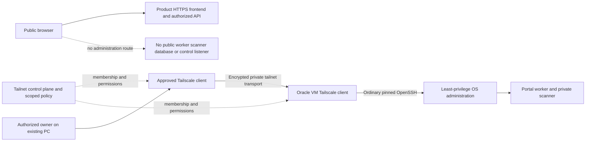

# Private PC-to-Oracle administration

Purpose: describe the existing administration trust boundary. Audience: authorized operators and reviewers. Classification: INTERNAL. Owner: Onesa infrastructure maintainer. Version: 1.0. Source review: 2026-10-14; current hosted verification belongs in restricted operations evidence.

The owner's PC and the Oracle Portal worker VM communicate over the existing Tailscale tailnet. This is the private administration path for the qualified worker host. Ordinary OpenSSH uses the previously pinned host identity over that encrypted path. Historical evidence records Tailscale SSH disabled, no subnet router, no exit node and no public forwarding; current effective settings must be read back before claiming they remain verified. Tailscale membership does not authorize Portal governance APIs, database access, production release or robot actuation.

Text alternative: owner identity and approved endpoints permit a scoped private PC-to-VM connection. Tailnet policy and OS authentication are separate controls. Public product traffic uses HTTPS application routes; it never gains worker administration through this tunnel.

## Policy and operational checks

Keep approved identities and least-privilege device/port grants. Preserve OS user ownership, key-only OpenSSH authentication, pinned host-key verification, private worker configuration and existing firewall. Check the effective grants/ACLs and device approval state in [the Tailscale console](https://console.tailscale.com/) through authorized access. Do not infer restrictive policy from an encrypted connection alone; Tailscale's default policy can allow broad access. Do not enable Tailscale SSH, Funnel, Serve, subnet routes, exit-node advertisement or new public listeners merely to simplify deployment.

Read-only qualification checks establish endpoint identity, client/service health, approved membership, key expiry, scoped effective connectivity, pinned host identity and actual SSH authentication. Denial probes must be scoped and harmless. Store private node IDs, addresses, identity details and policy receipts in restricted evidence; never include them in public Markdown, diagram exports, PDFs, screenshots or CI logs. Redact logs and avoid full status/environment dumps.

If the tunnel is unavailable, preserve running application/worker functionality and diagnose authentication, endpoint state, expiry, policy and transport separately. Do not silently open a public control port or replace trusted host keys. Use only the established authorized recovery path, with its existing evidence and secure credential location. Offboarding or a lost endpoint requires the owner's scoped revocation procedure; it is separate from changing application accounts.

The tunnel is an additional provider/infrastructure relationship for processor assessment. Its control-plane identity/device/connection metadata, actual plan, contract, retention and transfer decision require authoritative Portal governance review. This engineering document records the boundary; it is not a DPA acceptance or policy approval. Governance drafts never enable deletion or overwrite existing approvals.

## References and evidence limits

Official behavior references checked 2026-10-14: [Tailscale quickstart](https://tailscale.com/docs/how-to/quickstart), [ACL permissions](https://tailscale.com/docs/features/access-control/acls), [device approval](https://tailscale.com/docs/features/access-control/device-management/device-approval). These explain the product; they do not establish Onesa's actual account plan, policy or device state. Current observations and receipts remain attributable in the existing protected operations evidence.

Related: [Infrastructure](../ecosystem/INFRASTRUCTURE.md), [Complete architecture](../ecosystem/COMPLETE_ARCHITECTURE.md), [Security architecture](../security/SECURITY_ARCHITECTURE.md), [Day 4 operations](../onboarding/DAY_4.md). Change history: 2026-10-14 — include the existing PC-to-Oracle private administration boundary without public endpoint identifiers.
