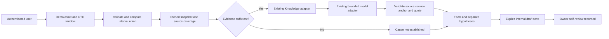

# Product requirements baseline

## Current interpretation and release status

The platform is pre-commercial, with implemented application capabilities and
source-bound hosted release records. It is not a mock-only product, and its
current infrastructure does not require a local NVIDIA host. The current product
hierarchy and proposed Industrial AI milestone are defined in the dated section
below. That milestone is not yet implemented or production-qualified.

Use [README](../../README.md), [CHANGELOG](../../CHANGELOG.md) and the
[deployment reference](../engineering/DEPLOYMENT.md) for maintained component
identities, actual acceptance scope and outstanding checks. A passing CI run or
this requirements document does not establish a fresh production verification.
Do not use the historical setup assumptions below as current deployment commands,
current provider bindings or evidence that an old blocker remains unresolved.

## Historical setup baseline

The following original setup description and milestone constraints are retained
for design history. They describe the initial mock-based development stage, not
the current serving system. Current requirements in the dated section below
supersede conflicting historical provider, infrastructure and acceptance status.

Original status: working local platform baseline. Chat/auth/persistence,
documents/retrieval, bounded tools and saved travel were verified with mock
inference; real provider and hosted acceptance had not yet been established.

Onesa AI is a European-based general-purpose modular AI platform for enterprise, developer,
institutional and consumer applications in European and international markets. Organizations
can build, deploy and customize intelligent applications on independently managed open-weight
infrastructure. Priorities include sovereignty, privacy-conscious access, useful general AI,
multilingual/multimodal extensibility, commercial/industrial applications and portable GPU serving.
African languages/regional knowledge remain additional specializations, not the primary identity.

See MARKET_SCOPE.md and USE_CASES.md for audiences and implemented/proposed boundaries.
The suggested “Intelligent Technology Without Boundaries” tagline remains draft copy.
Interface catalogs are independent of evaluated model capabilities. No certification,
regulatory compliance or funding eligibility follows from product positioning.

## MVP scope

Milestone 1 must allow registration/login, creating/renaming/deleting conversations,
sending messages, receiving labelled mock responses incrementally, and reopening
saved history. Users can only read and mutate their own data. No model credentials
or internal addresses appear in user-facing responses. CPU-only development and CI
must not download model weights. Desktop/mobile and keyboard flows must work.

Accept the MVP only after migration tests, auth/isolation tests, model failure and
stream cancellation tests, frontend checks/build, and a browser smoke flow pass.
Docker Compose must start API, PostgreSQL, and chat UI with documented configuration.
Performance targets will be established by measured baselines, not invented here.

## Milestone scope and pending acceptance

Historical milestone snapshot; not a statement of current release acceptance.

M2 enables real vLLM inference; M3 document ingestion/embeddings/pgvector; M4 agents;
M5 Travel; M6 dataset preparation and fine-tuning configuration; M7 release hardening.
M3–M6 software is now delivered; real-model/provider/training acceptance is still pending.
Vision and speech remain future model capabilities. Robotics is a downstream client;
no robot control or robotics dependencies belong in the platform core.

External travel prices, availability, and schedules require provider evidence.
Bookings require separately authorized integrations and confirmation. No expensive
training jobs, remote deployments, or large model downloads are part of the MVP.

## Constraints and open decisions

Historical setup assumptions. Consult the current records before interpreting
any listed infrastructure choice or open decision as current.

Use Python 3.11+, FastAPI, SQLAlchemy 2/Alembic, Next.js/TypeScript, PostgreSQL,
Docker Compose, and local NVIDIA/vLLM infrastructure. No Redis/Kubernetes until
requirements justify them. Model selection is configurable; Qwen is a candidate,
not a claim of hardware feasibility. License/ownership, production domain, GPU
capacity, retention policy, and suitable training data remain unresolved.

## Current product hierarchy and industrial milestone — 2026-10-20

This section supersedes the original mock-only positioning above. **Source verified:**
Chat, owned Knowledge retrieval, bounded registered tools and saved Travel exist.
**Release-record claim:** hosted generation, embeddings, account isolation and these
application journeys passed the separately recorded October19 release. Those receipts
are environment/source-specific; they are not a new independent observation or evidence
of industrial integrations. The active hosted model provider is configurable and includes
Cloudflare Workers AI; do not describe the current service as entirely self-hosted or
EU-only. Interface navigation/authentication has EN/DE catalogs; complete workspace
translation and domain/model language evaluation remain separate work.

Onesa UG is the company. Onesa AI Platform has **Applications** and **Industrial AI**
tracks. Onesa Robotics develops **Physical AI**, currently demonstrated through its
protected one-joint software simulator. Chat and Travel are application experiences,
not the complete company or a demonstrated industrial automation engine. No AGI,
vehicle autonomy, live factory integration or physical operation follows from this
hierarchy. Proposed positioning for owner review: connect operational knowledge and
machine context to traceable decisions and human-reviewed workflows.

### Industrial AI: investigate repeated machine stops

**V1 source implementation; hosted industrial acceptance is still pending.** One authorized analyst
selects one asset and a bounded time window. The assistant gathers read-only event
records, relevant time series, asset metadata and rights-cleared versioned manuals.
It separates observed facts, computed summaries and model hypotheses, cites sources,
shows gaps/freshness/uncertainty, and prepares an editable internal work-order draft.
A recorded owner self-review makes the decision within the current user-owned model;
it is not independent approval. The system does not send the draft to a CMMS,
write PLC settings, actuate hardware or automatically execute its recommendations.

The public static DEMO-01 example uses invented stops at 09:12 (4 min), 09:31 (3 min)
and 09:48 (5 min), UTC within 09:00–10:00. Three stops total 12 minutes. With no sensor
readings or approved manual, cause and corrective action are unknown. This arithmetic
example is not an inference result, customer case or operational integration.

#### Fixture and contract

Use isolated synthetic accounts and bundled `onesa-industrial-synthetic-v1` fixtures,
with no production records or credentials. Investigations belong to one existing user;
demo assets are shared synthetic references. This is not enterprise tenant isolation.
The implemented versioned input contains:

- `asset`: allowlisted synthetic ID, display label, equipment type and metadata version.
- `window`: inclusive start/exclusive end, explicit UTC timestamps and source timezone.
- `events`: immutable source ID, asset ID, start/end, reason code, quality and provenance.
- `series`: asset ID, signal, unit, timestamp, value, quality, expected sampling interval
  and freshness; reject ambiguous units, impossible ranges and future timestamps.
- `manuals`: permitted document/version, rights record, effective dates, page/section
  anchors, asset applicability and content hash. Treat instructions in documents as
  untrusted content, not execution authority.

The implemented API creates an investigation from authorized fixture references,
read its source-bound result, cancel generation, and edit/save a separate internal
work draft. Responses identify input versions, computed facts, cited hypotheses,
missing/stale inputs and model/configuration version. Draft creation is a distinct
explicit action. Existing user/object authorization applies before retrieval; synthetic
references are filtered by asset, version and effective interval. Cross-asset citations,
unsupported diagnosis and unauthorized source disclosure fail acceptance.

UI: asset/time selection → sources and freshness → observed facts → hypotheses with
citations/uncertainty → editable work draft → reviewer decision. Save failure retains
the draft, navigation warns before discard, session expiry preserves same-account
in-memory input without replaying submission. No sensitive draft browser persistence.
Audit only necessary actor/source/version/reviewer decisions; no raw model prompts,
manual bodies or private telemetry in public logs. Retention/processor decisions are
required before real customer data enters this workflow; G14 is not approved.

#### V1 event semantics and working scope

The backend clips stops to the inclusive-start/exclusive-end UTC window. Exact duplicate
IDs count once; conflicting duplicates fail validation. Known good intervals are unioned,
preserving every contributing event ID. Adjacent/overlapping intervals form one downtime
episode; event count and episode count remain distinct. Open-ended and poor-quality
inputs are reported separately, without inventing duration. Known downtime is a lower
bound when these inputs exist. Availability and OEE are not calculated. Units are
validated without implicit conversion; non-finite measurements and naive timestamps fail.

`/industrial` uses the existing session and user ownership. The demo flag defaults off.
All source selection comes from bundled original synthetic fixtures. The API persists
calculated facts and their input snapshot hash before inference. Knowledge's existing
embedding adapter ranks applicable references. The existing ModelClient generates bounded
hypotheses with source version/anchor validation and literal quotations. Numeric claims
belong in the fixed facts panel, not generated narrative. These checks are not a universal
semantic entailment guarantee. No factory connection, external ticket or physical operation
exists. Saving an internal draft is an explicit application write.

Missing, stale, conflicting or incomplete evidence triggers abstention. Mock output is
labelled. Failed/empty/invalid generation never becomes completed. Cancellation stops
the application operation but may not stop provider computation. Draft/review writes
use expected revisions; review records retain the exact draft hash and earlier decisions.
Editing invalidates the current review. A recorded self-review is not independent approval.

`scripts/evaluate_industrial.py` executes seven versioned cases, one repetition, exact
facts and mock/abstention outcomes. Its report distinguishes latency scope, failures,
unknown cost and unmeasured reviewer corrections. Manual lookup and general-assistant
comparisons are NOT RUN. Actual provider output, hosted demo and production hosting need
separate source-bound acceptance. Public marketing remains proposed until that scope passes.

#### Evaluation and acceptance before claiming benefit

Prepare a versioned synthetic evaluation set with normal operation, repeated stops,
wrong asset, mixed units, missing/stale series, conflicting/outdated manuals, prompt
injection, unauthorized documents, quota failure and model unavailability. Verify
exact expected fact totals and source identity independently of model wording.
Require abstention when evidence cannot support a diagnosis; model output cannot
invent a source or approve a tool. Use the same permitted information and tools for
manual lookup and a named general-assistant baseline. Record task completion time,
source support, wrong-asset/unit errors, stale-data handling, abstention, access
violations, reviewer acceptance and cost per successful investigation. Publish actual
sample counts, model/configuration, failures and uncertainty; do not invent uplift.

Consider an Asset Administration Shell mapping as a future schema choice. OPC UA,
MQTT, MES, ERP, CMMS and AAS connectivity are **not current integration claims**.
A thin implementation needs this milestone's reviewed data contracts, isolation,
rights and acceptance before it can qualify as demonstrated Industrial AI.

### Pilot and commercial readiness

Prepare 10–15 discovery interviews, 2–3 design-partner evaluations and 1–2 paid pilot
hypotheses, subject to owner approval and actual counterparts. These are targets,
not customers or traction. Define one asset/workflow, source access, success criteria,
data responsibilities, escalation, rollback, capacity and acceptance with each pilot.
Pricing hypothesis: scoped setup plus a recurring subscription with bounded usage;
measure provider tokens/embeddings/storage/support cost per accepted task first.
Do not promise unlimited inference, uptime/HA, grant eligibility, patents, software
ownership clearance or superiority over a general assistant. Model, dataset, image,
employment and contributor IP rights need their actual records. No outreach, payment,
new provider or real industrial processing is authorized by this specification.
